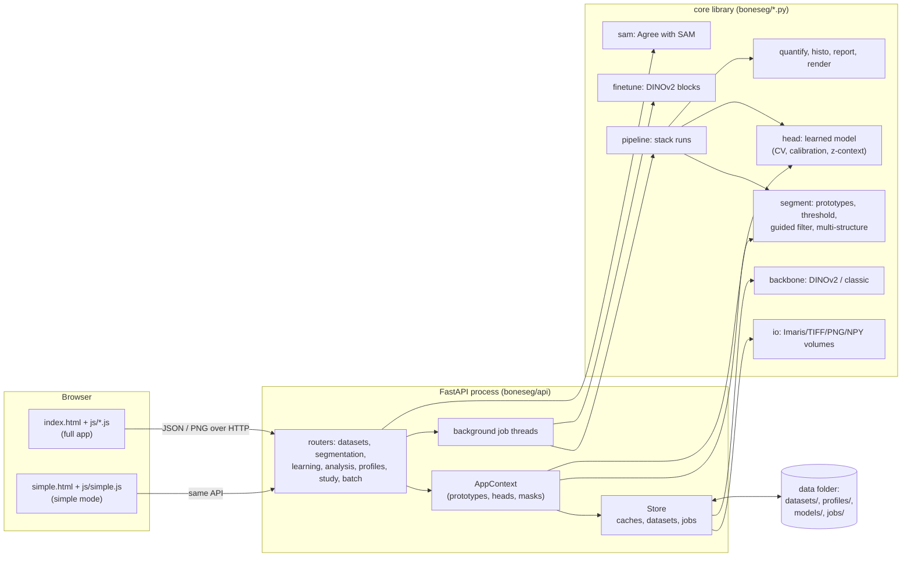

# Scope and method

**What was analysed.** The application package `boneseg/` (Python backend, about 4,000 lines; plain-JavaScript front end, about 2,300 lines), its tests (`tests/`, 108 test functions), the benchmark scripts (`scripts/`), packaging (`requirements*.txt`, `Dockerfile`, `ci/`) and, at a summary level, the research code in `paper/` and `notebooks/`. Skipped: generated notebook JSON, result CSVs and figures, data under `data/` and `projects/`, the virtual environment and caches.

**How.** Every file in `boneseg/` was read; behaviour that was unclear was checked by running code:

- the full test suite passes (119 tests in 2 min 13 s, including 14 browser tests);
- three issues below were reproduced with small scripts (concurrent annotation saves, PNG colour modes, 3D labelling memory); the scripts are described with each finding;
- installed dependency versions were compared with the newest releases (`pip list --outdated`).

Items that could not be confirmed by running code are marked **needs verification**. Findings from the earlier bug-hunting run that were already fixed (commit `b6b27f8`) are not repeated.

# 1. High-level overview

## What it does and for whom

boneseg segments structures (mainly bone, also cells) in microscopy images with very little manual work. A researcher opens an Imaris, TIFF, PNG/JPEG or NumPy file in a browser, clicks a few examples of the structure and of the background, and gets a mask with measurements in micrometres. From there the user can correct masks and train a small "learned model", run whole z-stacks, compute bone histomorphometry (B.Ar/T.Ar, Oc.Pm/B.Pm, N.Oc/B.Pm, 3D objects), fine-tune DINOv2 on their labels, compare samples between groups, and export masks, tables and reports. The target users are bone researchers without programming experience; a second, minimal page ("simple mode") reduces the workflow to open, click, run the stack, download. It runs locally on a laptop (Apple GPU, NVIDIA GPU or CPU) or on a lab server with an access token.

## Architecture

A single Python process runs a FastAPI server. It holds all state in a `Store` object (datasets, caches, profiles, jobs) backed by files under a data folder (`projects/` by default). The browser front end is static HTML and JavaScript served by the same process and talks to a JSON API. Long work (stack runs, training, fine-tuning, batch runs) runs in background threads ("jobs") that the browser polls.

## Data flow of one click

1. The browser sends `POST /api/datasets/{id}/segment` with the slice, channel, click positions (full-resolution pixels) and settings.
2. `Store.embedding` returns the slice's DINOv2 feature grid from the cache or computes it: the plane is read lazily (`io`), normalised (1st–99.5th percentile), resized to a multiple of the 14-pixel patch, embedded (optionally at 2 x 2 half-patch shifts), and cached by settings.
3. `segment_with_prototypes` takes the features under the clicks as prototypes, scores every cell as mean similarity to object prototypes minus λ times similarity to background prototypes, standardises the scores, upsamples them, snaps them to image edges with a guided filter, and thresholds at a position between the object and background clicks.
4. The response carries the mask and heat map as PNG data URLs, measurements, uncertainty and, with a reference mask, Dice and an error overlay. Neighbouring slices are prefetched in a background thread.

## Key technologies

Python 3.14, PyTorch 2.14 (MPS/CUDA/CPU), DINOv2 via `torch.hub` (pinned commit), FastAPI 0.142 and Starlette 1.7, pydantic 2.13, NumPy/SciPy/scikit-image/pandas, tifffile, h5py and `imaris-ims-file-reader` for Imaris files, Pillow, `segment-anything` (optional "Agree with SAM"), Playwright and pytest for tests. The front end uses no framework or build step.

# 2. Detailed walkthrough

## 2.1 Core library (`boneseg/`)

| Module | Responsibility | Key functions / classes | Connections and non-obvious logic |
|---|---|---|---|
| `io.py` (258) | Lazy multichannel z-stacks | `Volume`, `load_ims`, `load_tiff`, `load_image`, `load_npy`, `normalize_plane`, `add_colour_channel`, `labelled_slices` | Every format becomes a `Volume` with (channel, z, y, x) and a reader callback. Imaris is read one plane at a time; TIFFs are read whole (see W2). Colour images get a virtual "Colour (RGB)" channel. Voxel sizes come from Imaris metadata or ImageJ/TIFF tags. |
| `backbone.py` (184) | Feature extractors | `DinoBackbone`, `ClassicBackbone`, `get_backbone`, `pick_device`, `check_model_path` | Keeps at most one DINOv2 model in memory (`_cache`). `dinov2_s14@path` loads fine-tuned weights. `MODEL_DIRS` (a module global) restricts model paths on network servers. |
| `segment.py` (635) | Click segmentation | `SegmentationSettings` (with type/range validation), `embed_image`, `prototypes`, `score_grid`, `calibrate_threshold`, `auto_position`, `guided_filter`, `segment_with_prototypes`, `uncertainty_map`, `suggest_click`, `calibrate_multi`, `apply_multi`, `Profile` | The threshold sits between the weakest object click and the strongest background click (quantiles beyond five clicks), at position 0.7 or 0.9 ("Auto"). Scores are standardised per slice so a threshold carries through a stack. Multi-structure segmentation scores each structure against the background and the other structures. |
| `head.py` (337) | The learned model | `Head`, `fit`, `train_head`, `calibrate_threshold`, `with_z_context`, `head_input`, `smooth_z`, `train_head_multi` | Linear or 64-unit MLP over patch features, optional 5 x 5 neighbourhood mean, optional features of slices ~4 µm above/below; variant chosen by leave-one-slice-out CV; probability threshold calibrated on held-out predictions; label regions exclude pixels outside a region of interest. |
| `finetune.py` (247) | Fine-tuning DINOv2 | `SegNet`, `prepare`, `finetune`, `FineTuned`, `build`, `predict` | Trains the last k blocks plus a 1 x 1 head with BCE + Dice, AdamW, one-cycle, crop sampling biased to bone, early stopping on validation Dice; `init=` continues from another fine-tune; supports progress and cancellation. |
| `refine.py` (230) | Learned refiner | `RefinerNet`, `Refiner`, `train_refiner`, `simulate_clicks` | A small U-Net on image + score map, trained with simulated clicks; bundled model in `models/refiner_liu.pt`. |
| `sam.py` (89) | "Agree with SAM" | `sam_mask`, `agree`, `available` | SAM ViT-B on the CPU, weights downloaded on first use; image encoding cached per slice; keeps the intersection with boneseg's mask. |
| `store.py` (546) | Server state | `Store`, `Dataset`, `Job`, `LRU`, `ResultCache` | Datasets on disk (`dataset.json`, `annotations.json`, `labels/`, `heads/`), plane and embedding caches, profiles, jobs (`start_job` threads, `record_job`), one re-entrant `compute_lock` for all model work, background prefetch. |
| `pipeline.py` (227) | Stack runs | `run_stack`, `run_stack_multi`, `processing_order`, `_recent`, `_ReadAhead` | Walks outward from the clicked slice, reads the next plane in a thread, writes mask/label TIFFs, per-slice CSV, 3D objects and summaries. Keeps every mask in memory until the end (W1). |
| `quantify.py` (145) | Measurements | `summarize_mask`, `summarize_stack`, `label_3d`, `objects_3d`, `channel_intensities` | 3D objects use 6-connectivity on the whole mask stack. |
| `histo.py` (96) | Histomorphometry | `histomorphometry`, `overlay` | ASBMR 2D measures; cell contact within a distance of the bone surface; ROI edges are not counted as surface. |
| `render.py`, `report.py` | PNGs and HTML report | `mask_png`, `heat_png`, `error_png`, `build_report`, `methods_text` | All names from files are HTML-escaped in the report. |
| `batch.py`, `study.py` | CLI batch runs and group comparison | `run_batch`, `resolve_profile`; study rows and rank test | The CLI reuses `run_stack`. |
| `demo.py`, `__main__.py` | Synthetic demo stack; CLI | `serve` (with `--simple`, `--token`, `--allow-paths`), `batch`, `profiles`, `finetune`, `train-refiner` | |

## 2.2 Web API (`boneseg/api/`)

`create_app` builds the FastAPI app, the optional token middleware (cookie or Bearer, compared with `hmac.compare_digest`), maps `KeyError`/`ValueError`/`IndexError` to 404/400 JSON, serves `/` and `/simple`, and mounts seven routers (47 routes):

- **`datasets.py`**: list, multipart upload, streamed upload (raw body to a temporary file, then renamed), demo, open by path (only when allowed), metadata patch, region of interest, delete, plane PNG (cached one hour by the browser), side view, reference mask.
- **`segmentation.py`**: single and multi-structure segmentation (incl. `clicks_z` and Agree with SAM), exports, stack jobs (one per dataset, 409 otherwise), running-job listing, job status/cancel/files.
- **`learning.py`**: clicks (annotations), labels (incl. labels from the reference and label regions), training the learned model (synchronous or as a job), model export as a profile, DINOv2 fine-tuning job.
- **`analysis.py`**: HTML report, histomorphometry for a slice or a stack (job), project zip export.
- **`profiles.py`, `study.py`, `batch.py`**: profile CRUD/import/download, group comparison, batch runs over samples.
- **`context.py`**: shared helpers (prototypes from clicks or profiles, compatible heads, `head_embedding` for z-context models, masks from a source spec).
- **`models.py`**: pydantic request bodies.

## 2.3 Front end (`boneseg/static/`)

- **`index.html` + `js/core.js, datasets.js, segment.js, viewer.js, learn.js, panels.js, jobs.js, main.js`**: plain scripts sharing a global state object `S`, loaded in order. `core.js` holds the API helper, escaping, shared click saving (`scheduleSave`, `flushSaves`, beacon on `pagehide`), shared undo (`undoEntry`), view hand-over between pages, units. `viewer.js` draws the canvas (zoom, pan, overlays, brush). `jobs.js` polls jobs.
- **`simple.html` + `js/simple.js`**: a self-contained minimal page with its own canvas, using `core.js` helpers and the same API.

## 2.4 Tests, scripts, packaging, research code

- **`tests/`**: `test_core.py` (segmentation, heads, metrics, formats), `test_api.py` (API flows on synthetic stacks, mostly with the fast "classic" backbone), `test_bugfixes.py` (regression tests for the bug hunt), `test_formats.py`, `test_ims.py` (an Imaris writer in `ims_writer.py`), `e2e/test_browser.py` (Playwright flows of both pages).
- **`scripts/`**: benchmarks on the demo and on Liu files.
- **Packaging**: `requirements.txt` (unpinned except the Imaris reader), `Dockerfile` (CPU), a GitHub Actions workflow kept in `ci/` (not enabled).
- **`paper/`**: evaluation scripts (nested leave-one-sample-out, NOISe, SegPC, 3D, fine-tuning, SAM comparisons, robustness), Kaggle notebook generator, results and figures. **`notebooks/`**: the original research notebook and its result CSVs.

# 3. Bugs

Eight defects were found that can be pointed to in the code; fewer than ten, so the list stops there.

### B1. Concurrent click saves corrupt `annotations.json` (data loss) — **critical**

- **Where**: `boneseg/store.py:355` (`set_annotation`), and the same pattern in `_save_meta` (`store.py:182`) used by every metadata update.
- **What**: each save reads the whole JSON file, changes one key and rewrites the file, with no lock and no atomic replace. FastAPI runs these synchronous endpoints in a thread pool, so two saves can interleave.
- **Trigger**: the front end now sends several saves at once (`flushSaves` before switching image, one timer per slice, beacons on page close), or two tabs edit the same image. Reproduced: 40 parallel `set_annotation` calls on one dataset left the file unreadable (`JSONDecodeError: Extra data`), after which every `GET /annotations` for that image fails and all its clicks are lost. Without corruption, interleaved writes silently drop other slices' clicks.
- **Fix**: a per-dataset `threading.Lock` around read-modify-write in `set_annotation` and `update_meta`, and atomic writes (write to `annotations.json.tmp`, `os.replace`). Longer term, SQLite (see I1).

### B2. Multi-structure segmentation misses the method-v2 improvements — **high**

- **Where**: `boneseg/segment.py:585–631` (`calibrate_multi`, `apply_multi`).
- **What**: single-structure segmentation applies the guided edge filter (`refine_scores`) and the automatic threshold position 0.7/0.9 (`auto_position`). The multi-structure path calls `calibrate_threshold` with the default position 0.5 and never calls `refine_scores`. The evaluation showed that the v2 changes cut the bone-area overestimate from +6.6 to +2.0 points.
- **Trigger**: segment "bone matrix" and "cells" together; the bone mask is looser than the same clicks give with one structure, and stack histomorphometry from a multi-structure run inherits the overestimate.
- **Fix**: pass `auto_position(settings.threshold_position, n_pos, n_neg)` to `calibrate_threshold` and run `refine_scores` on each structure's raw map before comparison, then add a test that one structure segmented alone and in a multi-structure run with the same clicks agree.

### B3. Grey-with-alpha and palette PNGs are read wrongly — **medium**

- **Where**: `boneseg/io.py:211` (`load_image`).
- **What**: `np.asarray(img)` is used without converting the PIL mode. An `LA` image becomes 2 channels with 3 names (`Red, Green, Blue`), the alpha channel shown as "Green"; a palette (`P`) image becomes its colour-table indices (values 0–7 in the test) instead of intensities.
- **Trigger**: reproduced with generated `LA` and `P` PNGs. Palette PNGs are common from some screenshot and export tools.
- **Fix**: `img = img.convert("L")` for `L`, `LA`, `I;16`-like grey modes (keeping 16-bit), `img.convert("RGB")` for `P`, `RGBA`, `CMYK`; and name channels from the converted array's shape.

### B4. Saved z-context models use a slice distance, not a physical one — **medium**

- **Where**: `boneseg/head.py:52–65` (`z_context_slices`, `head_input`).
- **What**: a model trained on a stack stores `z_context` in slices (2 for 2 µm slices). Applied through a profile to a stack with another spacing, it looks a different physical distance away; applied to a single 2D image, both neighbours clamp to the slice itself, which creates inputs it never saw in training.
- **Trigger**: "Save model as profile" on a Liu stack, then run it in "Compare samples" on a 1 µm stack or on PNG images.
- **Fix**: store the distance in µm in the head, convert per target stack with `z_context_slices(vol.voxel_um[0], n_z)`, and refuse (or warn) when the target cannot provide neighbours.

### B5. Fine-tuning uses the GPU without the model lock — **medium, needs verification**

- **Where**: `boneseg/api/learning.py:221–232` (fine-tune job) against the design note in `store.py:152` ("GPU backends such as Apple MPS crash when used from several threads at once").
- **What**: the fine-tune job trains on the GPU in its own thread without `compute_lock`, while interactive segmentation and prefetch use the GPU under the lock.
- **Trigger**: start a fine-tune and keep segmenting. The bug-hunting run did this once without a crash, so the risk is unconfirmed.
- **Fix**: either hold `compute_lock` per training step (slower interaction) or run fine-tuning on a separate device/process; at least document the choice.

### B6. Prefetch with outdated settings blocks interactive requests — **medium**

- **Where**: `boneseg/api/segmentation.py:100` and `boneseg/store.py:314` (`prefetch`).
- **What**: every segment request starts a thread that embeds the four neighbouring slices with that request's settings, never cancelled. After switching from a slow backbone (DINOv2 Large) to a fast one, queued prefetches hold `compute_lock` for about 13 s per slice.
- **Trigger**: reported by the bug hunt (BUG-18): a Classic request took 15 s after a Large request. Not fixed.
- **Fix**: a prefetch generation counter that drops queued slices when a request with different embedding settings arrives, and skipping prefetch when one embedding took longer than ~2 s.

### B7. Space bar is swallowed on focused buttons — **low**

- **Where**: `boneseg/static/js/main.js:213`.
- **What**: the global key handler calls `preventDefault()` for Space (used for panning) unless focus is in a text field, so a keyboard user cannot press a focused button or tick a checkbox with Space.
- **Fix**: ignore the shortcut when `e.target` is a button, checkbox, radio, summary or link.

### B8. Small text defects — **low**

- "1 slices" for 2D images (`datasets.js:52`, `panels.js:138`), "cyan: latest stack run" also for multi-structure runs drawn in structure colours (`panels.js:20`), 0-based slice numbers in the full app against 1-based in simple mode, and a report caption that always mentions a region of interest. Fix: pluralise, take the legend from the run's structures, and use one numbering convention.

# 4. Weaknesses

Ten risks, most important first.

### W1. Stack runs keep everything in memory at full resolution — **high, needs verification**

- **Where**: `boneseg/pipeline.py:54, 84, 92–93`; `boneseg/quantify.py:116`.
- **Risk**: all masks are held in a dict, stacked twice (uint8 for the TIFF, bool for labelling) and labelled in 3D with an `int32` array. For Liu sample C at full resolution (2048 x 1725 x 505 slices) the label array alone is 7.1 GB (checked with the actual dtype), plus about 1.8 GB per mask copy, on a 16 GB laptop that also holds the model. The default slice step in the UI (about 50 slices per stack) hides this; "Every 1" on a large stack can run out of memory.
- **Fix**: append slices to the TIFF as they are produced, label in 3D on a downsampled stack or with a chunked connected-components library, or skip 3D objects above a voxel budget with a clear message.

### W2. Whole TIFF stacks are loaded into memory, and the plane cache is bounded by count only — **high**

- **Where**: `boneseg/io.py:201` (`series.asarray()`), `boneseg/store.py:160–180` (`_load_existing` reopens every dataset at start-up), `boneseg/store.py:149` (`LRU(64)` without a byte limit).
- **Risk**: a multi-gigabyte TIFF uses that much RAM as soon as it is opened, and again at every server start; 64 cached planes of a 3000 x 3000 image (raw plus float32 normalised) can reach several GB.
- **Fix**: lazy TIFF reading (`tifffile.memmap` for contiguous files, `series.aszarr()` otherwise) and a byte budget for the plane cache, as the embedding cache already has.

### W3. The local server trusts any web page that can reach it — **medium (security), needs verification**

- **Where**: `boneseg/api/__init__.py:43–66` (no Host check, no CSRF protection, no size limits), `boneseg/api/datasets.py:28, 37` (uploads), `datasets.py:65` (open by path, on by default on localhost).
- **Risk**: without a token, a malicious page could use DNS rebinding (a hostname that resolves to 127.0.0.1) to become same-origin with the app and open and read image files on the user's disk through "open by path" and the plane endpoint. Multipart uploads are "simple" requests, so any page can send them cross-origin and fill the disk; there is no upload size limit even with a token.
- **Fix**: Starlette's `TrustedHostMiddleware` limited to `localhost`/`127.0.0.1` (plus configured hosts) when serving locally, a maximum upload size, and an `Origin` check for state-changing requests.

### W4. The project export leaks other users' profiles and server paths, and is built in memory — **medium**

- **Where**: `boneseg/api/analysis.py:110–124`.
- **Risk**: the zip contains every profile on the server (not only this image's) and the absolute server path of the image in `dataset.json`; on a shared lab server that discloses other people's work. With `include_masks=true` the whole archive, including mask stacks, is assembled in a `BytesIO`.
- **Fix**: include only profiles created from this dataset (record the dataset id in profiles), drop the absolute path, and stream the zip to a temporary file returned with `FileResponse`.

### W5. Learned models are loaded with full pickle support — **low (security)**

- **Where**: `boneseg/head.py:124` (`torch.load(..., weights_only=False)`).
- **Risk**: today these files are only written by the server itself, so the risk is low; it becomes code execution if heads are ever imported (as profiles are). Profiles and fine-tuned models already use safe loading (`allow_pickle=False`, `weights_only=True`).
- **Fix**: save heads as a dict of tensors plus JSON metadata and load with `weights_only=True`.

### W6. One global lock and unmanaged threads — **medium (performance)**

- **Where**: `boneseg/store.py:152` (`compute_lock`), `store.py:479` (`start_job` starts a thread per job), `store.py:314` (a thread per prefetch).
- **Risk**: a stack run, a batch run and interactive segmentation all queue on one lock, so the viewer stalls during long jobs; there is no limit on concurrent job threads.
- **Fix**: a single model worker with a priority queue (interactive before prefetch before jobs) and a bounded job executor.

### W7. Job outputs are never cleaned up — **medium (disk)**

- **Where**: `boneseg/store.py:479–530` (jobs written to `jobs/<id>/`, kept forever and reloaded at start-up).
- **Risk**: every stack run writes mask and label TIFFs; full-resolution runs of large stacks are gigabytes each.
- **Fix**: a retention policy (keep the newest N runs per dataset, or delete with the dataset) and a "Delete run" action.

### W8. Switching backbones reloads models repeatedly — **low (performance)**

- **Where**: `boneseg/backbone.py:150–170`.
- **Risk**: only one DINOv2 model is kept. A job using one backbone and the viewer using another evict each other on every slice, each reload taking seconds.
- **Fix**: keep the models a running job needs pinned, or allow two models when memory permits.

### W9. Tests rarely exercise the real models — **medium (quality)**

- **Where**: `tests/` (most API and browser tests use the "classic" backbone; SAM and fine-tuning are replaced by fakes in their tests); `ci/` (workflow not enabled).
- **Risk**: changes that break DINOv2 embedding at real sizes, the fine-tuning loop, SAM or memory behaviour on large stacks are not caught; there are no concurrency tests (B1 would have been caught).
- **Fix**: a small CPU test with DINOv2 Small on a 140 px image, a fine-tune smoke test with a stand-in model (as in `test_bugfixes.py`), a concurrency test for saves, a golden-mask regression test, and enabling the CI workflow.

### W10. Reproducibility of the environment — **low (maintainability)**

- **Where**: `requirements.txt` (no versions except `imaris-ims-file-reader==0.1.8`), no lock file, `backbone.MODEL_DIRS` set as a module global per app (`api/__init__.py:55`).
- **Risk**: a future release of PyTorch, FastAPI or scikit-image can change behaviour silently. The installed versions are current (FastAPI 0.142.2 vs 0.143.0, NumPy 2.5.3 vs 2.5.4, pydantic 2.13.5 vs 2.14.0 available), so this is about the future, not outdated packages. The module global leaks between apps in one process (tests).
- **Fix**: a `pyproject.toml` with lower and upper bounds plus a lock file (e.g. `uv lock` or pip-tools), and model-path policy stored on the app context.

# 5. Improvements

| # | What to change | Why | Effort |
|---|---|---|---|
| I1 | Store annotations, metadata, labels index and jobs in SQLite (or at least locked, atomic JSON writes) | Fixes B1 at the root, survives crashes, allows several users per server | Small (atomic writes) to medium (SQLite) |
| I2 | Stream stack runs: write slices as they finish (`tifffile.TiffWriter` with `append`), compute 3D objects on a downsampled stack or chunk-wise, report progress per stage | Removes the main memory risk (W1); whole-stack runs of large Imaris files become safe | Medium |
| I3 | Lazy TIFF access via `tifffile` memmap or `aszarr`, a byte-bounded plane cache | Opening large TIFF stacks no longer needs their size in RAM (W2) | Small |
| I4 | Harden the server: `TrustedHostMiddleware`, upload size limit, Origin check for POST/PUT/PATCH/DELETE, `Secure` cookie when served over HTTPS, document running behind a reverse proxy with TLS for lab servers | Closes the DNS-rebinding and cross-site upload paths (W3) | Small |
| I5 | Bring the v2 pipeline to every path: guided filter and automatic threshold position in multi-structure segmentation (B2), and evaluate the guided filter on the learned model's probabilities (currently not applied) | Consistent, better masks for several structures; possibly sharper learned-model boundaries | Medium (plus an evaluation run) |
| I6 | A model worker with a priority queue; cancellable prefetch; bounded job executor; job retention policy | Responsive viewer during long jobs (W6, B6), bounded disk use (W7) | Medium |
| I7 | Store the z-context distance in µm and check compatibility when a profile is applied (B4); refuse z-context models on 2D images | Correct neighbouring-slice features across stacks | Small |
| I8 | Testing and CI: real-model smoke tests on CPU, concurrency tests, a golden-mask regression test, large-stack memory test with a synthetic memmapped volume, enable the GitHub Actions workflow | Catches the classes of bugs found here before users do (W9) | Medium |
| I9 | Packaging: `pyproject.toml` with an entry point (`boneseg serve`), a lock file, a CUDA variant of the Docker image, and optionally a napari plugin wrapping the core library | Easier installation for labs, reproducible environments, and access from the tool many microscopists already use | Medium to large |
| I10 | Product: a box tool that sends one box per object to SAM for cell counting (zero-shot SAM with boxes beat boneseg's box mode on osteoclasts and plasma cells in the evaluation), noise/dimming augmentation for the learned model (the robustness study found it most sensitive to strong noise), and a feature upsampler (e.g. LoftUp, arXiv:2504.14032) to sharpen DINOv2's patch-limited boundaries | Addresses the three weakest results in the project's own evaluation | Large |

# Second pass

A second pass over the code looked specifically for issues missed in the first: error paths (exception handlers map `KeyError`/`ValueError`/`IndexError` to readable 4xx responses; pydantic validation returns 422), escaping (file and profile names are escaped in the report, the dataset list, simple mode's recent list and Compare samples), path handling (upload names are reduced to their base name; profile ids are validated; model paths are confined on network servers), resource cleanup (temporary upload files are removed; Imaris files stay open for the process lifetime, which is intended), and front-end races (slice and overlay loads now drop out-of-date responses). It added B3, B4, B7, W4 and W8 to the list; nothing else rose to the level of a defect or a concrete risk.

# Summary of verification

| Finding | Verified by |
|---|---|
| B1 | Reproduced: 40 parallel saves corrupted `annotations.json` |
| B2 | Code reading (`calibrate_multi` has no position argument and no `refine_scores` call) |
| B3 | Reproduced with generated `LA` and `P` PNGs |
| B4 | Code reading |
| B5 | Code reading; not reproduced (needs verification) |
| B6 | Reported and measured by the earlier bug-hunting run; code unchanged since |
| W1 | `label_3d` dtype checked (`int32`); memory figure computed for sample C; full run not attempted (needs verification) |
| W3 | Code reading; exploit not attempted (needs verification) |
| Tests | `pytest tests`: 119 passed |
